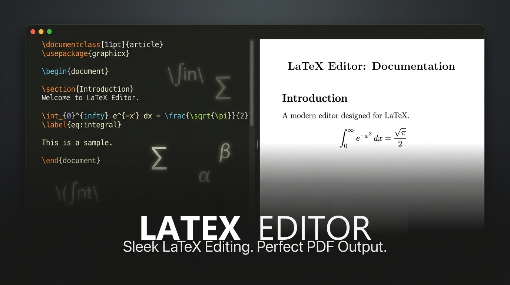

<div align="center">
  
  
  # LaTeX Editor
  
  [](LICENSE)
  [](#)
  [](https://github.com/Bandetheighteen/latex-editor/releases)
  [](#)
</div>

LaTeX is mandatory for PhD scholars, academics, and researchers worldwide. While web-based tools like Overleaf are popular, they require a constant internet connection, making offline drafting frustrating and precarious.

**LaTeX Editor** is a lightweight, crash-free, 100% offline native desktop IDE featuring an Apple HIG-inspired dual-pane interface: a CodeMirror 5 code editor on the left and a live PDF.js preview on the right with precision bidirectional SyncTeX navigation and native Microsoft Word (`.docx`) export.

---

## 📥 Downloads & Releases

Get the standalone installer or package for your operating system:

| Platform | Architecture | Package Format | Direct Download | Size |
|---|---|---|---|---|
| **Windows 10 / 11** | `x86_64` | Native Installer (`.exe`) &bull; **v2.0.0** | [**Download for Windows (v2.0.0)**](https://github.com/Bandetheighteen/latex-editor/releases/download/v2.0.0/LaTeX-Editor-Setup-v2.0.0.exe) <br/> *(or from repo: [`release/LaTeX-Editor-Setup-v2.0.0.exe`](release/LaTeX-Editor-Setup-v2.0.0.exe))* | 26.6 MB |
| **macOS (Apple Silicon)** | `aarch64` (M1/M2/M3/M4) | Disk Image (`.dmg`) &bull; **v2.0.0** | [**Download for macOS (.dmg)**](https://github.com/Bandetheighteen/latex-editor/releases/download/v2.0.0/LaTeX.Editor_2.0.0_aarch64.dmg) | 45.7 MB |
| **macOS (Apple Silicon)** | `aarch64` | App Archive (`.tar.gz`) &bull; **v2.0.0** | [**Download for macOS (.tar.gz)**](https://github.com/Bandetheighteen/latex-editor/releases/download/v2.0.0/LaTeX-Editor_2.0.0_aarch64.app.tar.gz) | 45.6 MB |
| **Linux (Ubuntu / Debian / Mint)** | `amd64` | Debian Package (`.deb`) &bull; **v2.0.0** | [**Download for Debian/Ubuntu**](https://github.com/Bandetheighteen/latex-editor/releases/download/v2.0.0/LaTeX.Editor_2.0.0_amd64.deb) | 38.8 MB |
| **Linux (Universal Portable)** | `amd64` | Standalone AppImage (`.AppImage`) &bull; **v2.0.0** | [**Download AppImage**](https://github.com/Bandetheighteen/latex-editor/releases/download/v2.0.0/LaTeX.Editor_2.0.0_amd64.AppImage) | 111.9 MB |
| **Linux (Fedora / RHEL / openSUSE)** | `x86_64` | Red Hat Package (`.rpm`) &bull; **v2.0.0** | [**Download for Fedora/RHEL**](https://github.com/Bandetheighteen/latex-editor/releases/download/v2.0.0/LaTeX.Editor-2.0.0-1.x86_64.rpm) | 38.8 MB |

> 🚀 **Multi-Platform Version 2.0 (v2.0.0) is officially live across Windows, macOS, and Linux!** Version 2 introduces the **Welcome & Projects Dashboard**, **Direct Disk File Saving (`Ctrl+S` / `Cmd+S`)**, **OS File Associations ("Open With...")**, and **Overleaf-Style Autocomplete & Snippet Expansion** (`\begin` suggestions).
> The release installer is also bundled right inside this repository under the [`release/`](release/) folder: [**`release/LaTeX-Editor-Setup-v2.0.0.exe`**](release/LaTeX-Editor-Setup-v2.0.0.exe) (also mirrored as [**`release/LaTeX-Editor-Native-Setup.exe`**](release/LaTeX-Editor-Native-Setup.exe)).
> 
> 📌 **Looking for all releases and tags?** Visit the **[GitHub Releases Page](https://github.com/Bandetheighteen/latex-editor/releases)**.

---

## 🚀 Installation & Setup Guides

Running LaTeX locally requires a TeX engine installed on your computer to compile `.tex` files into PDF typesetting. Follow the dedicated setup guide for your operating system:

<details open>
<summary><h3>🪟 Windows Setup Guide (Version 2.0)</h3></summary>

#### Step 1: Install a TeX Distribution
Before launching LaTeX Editor, ensure you have **MiKTeX** (recommended) or **TeX Live** installed so `pdflatex` is available on your computer.

- **Option A (Terminal via winget - Fastest):**
  ```powershell
  winget install MiKTeX.MiKTeX
  ```
  *(After the installer finishes, launch MiKTeX from your Start Menu once to let it complete its initial configuration wizard).*
- **Option B (Manual Download):**
  Download the Windows installer directly from **[miktex.org/download](https://miktex.org/download)**.

#### Step 2: Install LaTeX Editor v2.0
1. Download the Windows v2.0 installer using any of these options:
   - **GitHub Release Direct Link:** [**`LaTeX-Editor-Setup-v2.0.0.exe`**](https://github.com/Bandetheighteen/latex-editor/releases/download/v2.0.0/LaTeX-Editor-Setup-v2.0.0.exe)
   - **Repository Direct Download:** Grab the pre-built installer from the [`release/`](release/) folder: [**`release/LaTeX-Editor-Setup-v2.0.0.exe`**](release/LaTeX-Editor-Setup-v2.0.0.exe) or [**`release/LaTeX-Editor-Native-Setup.exe`**](release/LaTeX-Editor-Native-Setup.exe)
2. Double-click the installer and complete the setup wizard.
3. Launch **LaTeX Editor** directly from your Desktop or Start Menu!
4. **"Open With..." Integration:** Once installed, you can right-click any `.tex`, `.latex`, `.md`, or `.txt` file anywhere on your laptop, choose **"Open with..." &rarr; "LaTeX Editor"**, and edit the file directly with `Ctrl + S` disk saving!

> **Windows SmartScreen Tip:** Because LaTeX Editor is an independent open-source project without an enterprise code-signing certificate, Windows SmartScreen may show an informational notice on first run. Simply click **"More info"** &rarr; **"Run anyway"**.
</details>

<details open>
<summary><h3>🍏 macOS Setup Guide</h3></summary>

#### Step 1: Install MacTeX / BasicTeX
Install MacTeX or lightweight BasicTeX to provide the TeX compilation binaries:

- **Via Homebrew (Recommended):**
  ```bash
  # Standard MacTeX without GUI utilities:
  brew install --cask mactex-no-gui

  # Or lightweight BasicTeX:
  brew install --cask basictex
  ```
- **Manual Download:**
  Download MacTeX directly from **[tug.org/mactex](https://tug.org/mactex/)**.

#### Step 2: Install LaTeX Editor
1. Download **[`LaTeX.Editor_2.0.0_aarch64.dmg`](https://github.com/Bandetheighteen/latex-editor/releases/download/v2.0.0/LaTeX.Editor_2.0.0_aarch64.dmg)**.
2. Double-click the `.dmg` file to open it.
3. Drag the **LaTeX Editor** icon into your **Applications** folder.
4. Launch **LaTeX Editor** from Spotlight or Launchpad!

> **macOS Gatekeeper Tip:** On first launch, macOS may show a prompt: *"Apple cannot check it for malicious software"*. To open:
> 1. Right-click (or Control-click) on **LaTeX Editor** in `/Applications`.
> 2. Select **Open**.
> 3. Click **Open** in the dialog. You only need to do this once.
</details>

<details open>
<summary><h3>🐧 Linux Setup Guide</h3></summary>

#### Step 1: Install TeX Live
Install TeX Live packages using your distribution's package manager:

- **Ubuntu / Debian / Linux Mint / Pop!_OS:**
  ```bash
  sudo apt update
  sudo apt install -y texlive-latex-base texlive-latex-extra texlive-binaries
  ```
- **Fedora / RHEL / CentOS:**
  ```bash
  sudo dnf install -y texlive-scheme-basic texlive-synctex
  ```
- **Arch Linux / Manjaro:**
  ```bash
  sudo pacman -S --noconfirm texlive-basic texlive-bin
  ```

#### Step 2: Install LaTeX Editor
Choose the package format preferred for your system:

- **Option A: Standalone AppImage (Universal - No installation required)**
  ```bash
  # 1. Download LaTeX.Editor_2.0.0_amd64.AppImage
  # 2. Make it executable:
  chmod +x LaTeX.Editor_2.0.0_amd64.AppImage
  # 3. Run:
  ./LaTeX.Editor_2.0.0_amd64.AppImage
  ```
- **Option B: Debian / Ubuntu Package (`.deb`)**
  ```bash
  sudo dpkg -i LaTeX.Editor_2.0.0_amd64.deb
  # If any missing system dependencies are reported, run:
  sudo apt-get install -f
  ```
- **Option C: Fedora / RHEL Package (`.rpm`)**
  ```bash
  sudo dnf install ./LaTeX.Editor-2.0.0-1.x86_64.rpm
  ```
</details>

---

## ⌨️ Global Keyboard Shortcuts

| Shortcut (Windows / Linux) | Shortcut (macOS) | Action |
|---|---|---|
| `Ctrl + S` | `Cmd + S` | **Save Document Directly to Disk & Compile** (v2.0) |
| `Ctrl + Enter` | `Cmd + Enter` | Compile LaTeX Document |
| `Ctrl + Space` | `Cmd + Space` | **Trigger LaTeX Autocomplete & Suggestions** (v2.0) |
| `Ctrl + =` or `Ctrl + +` | `Cmd + =` or `Cmd + +` | Zoom In PDF Preview |
| `Ctrl + -` | `Cmd + -` | Zoom Out PDF Preview |
| `Single Click` / `Double Click` | `Single Click` / `Double Click` | Jump from PDF point to LaTeX Source Line (SyncTeX) |

---

## ✨ Core Features

- **Projects & Workspaces Dashboard (v2.0):** Beautiful dashboard welcoming you on launch. Quickly open recent documents with file size and timestamp badges, search/filter recent projects, pick from pre-configured Quick Starters (Research Article, Beamer Presentation, Resume/CV, Math Cheatsheet), or create a fresh blank project.
- **Direct Disk Saving & OS File Associations (v2.0):** Work directly on your computer's `.tex`, `.latex`, `.ltx`, `.txt`, and `.md` files without copying and pasting. Right-click any text or LaTeX file in your file explorer (Windows Explorer, macOS Finder, Linux Files) &rarr; **Open with LaTeX Editor**. Press `Ctrl + S` / `Cmd + S` to save changes directly to disk with atomic write protection.
- **Overleaf-Style Autocomplete & Suggestions (v2.0):** Get intelligent suggestions as you code. Type `\begin` for an instant dropdown with automatic snippet expansion (`itemize`, `enumerate`, `equation`, `align`, `figure`, `table`, etc.), standard LaTeX macros, math symbols, and active document `\label` discovery for `\ref` and `\cite`.
- **Project-Relative Asset Compilation (v2.0):** Figures (`\includegraphics{images/...}`) and multi-file subdocuments (`\input{sections/...}`) compile relative to the active document's parent directory.
- **100% Offline Workflow:** Zero reliance on remote servers, internet connections, or subscription clouds like Overleaf. Work anywhere: on airplanes, field sites, or remote locations.
- **Precision Bidirectional SyncTeX:** Clicking or double-clicking anywhere on the PDF preview resolves coordinate math and high-DPI scaling ratios, jumps to the exact source line in CodeMirror, centers it in the viewport, and pulses it with a luminous green highlight.
- **Auto-Compilation Toggle:** Dedicated header toggle (`ON` / `OFF`) defaulting to OFF. Draft freely without interruption, and compile on demand (`Ctrl+S` / `Cmd+S`) or enable auto-compilation with a 1200ms debounce.
- **Unified Export (PDF & Word .docx):** Export directly to `.pdf` or native Microsoft Word (`.docx`). Equations are automatically converted into native, fully editable Microsoft Word Equation Editor (OMML) objects using a bundled offline Pandoc converter.
- **Runaway Process Safeguard:** Strict 10-second child process timeouts cleanly kill runaway compilation loops without crashing the IDE or freezing your CPU.
- **Apple HIG-Inspired Dark Aesthetic:** Sleek, distraction-free interface built with native typography and smooth resizable split panes.

---

## 🛠️ Architecture

- **Frontend:** CodeMirror 5 (with active line spotlighting, syntax highlighting, and `show-hint` autocompletion), PDF.js (offline canvas rendering), and Split.js (smooth resizable dual-pane layout).
- **Backend (Tauri v2 & Rust):** Manages child processes (`pdflatex`, `synctex`, `pandoc`), enforces memory safety, atomic file saving, launch argument parsing for "Open With...", recent project history persistence, native file dialogs, and maps platform-specific environment PATHs (`/Library/TeX/texbin`, Homebrew, system binaries).
- **Converter:** Embedded standalone Pandoc engine for direct Word `.docx` conversion with OMML equations.

---

## 🔨 Build from Source (Developers)

If you wish to compile LaTeX Editor from source on your machine:

```bash
# 1. Clone repository
git clone https://github.com/Bandetheighteen/latex-editor.git
cd latex-editor

# 2. Install Node dependencies
npm install

# 3. Download offline vendor assets (CodeMirror, PDF.js, Split.js) and Pandoc binary
npm run setup

# 4. Run desktop app in development mode
npm run dev

# 5. Package release binary for your OS
npm run build
```

---

## 👨‍💻 Author

This project was built and designed by **Shounak Saha**.

> *"I am a non-coder with no formal background in software engineering. I hardcoded and vibe-coded this entire application from the ground up to solve the real everyday frustrations my research peers and I faced while writing LaTeX papers offline.*
> 
> *I warmly welcome open-source developers, researchers, and LaTeX enthusiasts to collaborate, submit pull requests, open issues, and help improve this tool together!"*

- **GitHub:** [@Bandetheighteen](https://github.com/Bandetheighteen)
- **Portfolio / Connect:** [linktr.ee/shounaksaha2000b](https://linktr.ee/shounaksaha2000b)

---

## 📄 License

This project is licensed under the **[MIT License](LICENSE)** &copy; 2026 **Shounak Saha**.

You are free to use, modify, distribute, and collaborate on this project, provided that the original copyright and permission notice are preserved.
